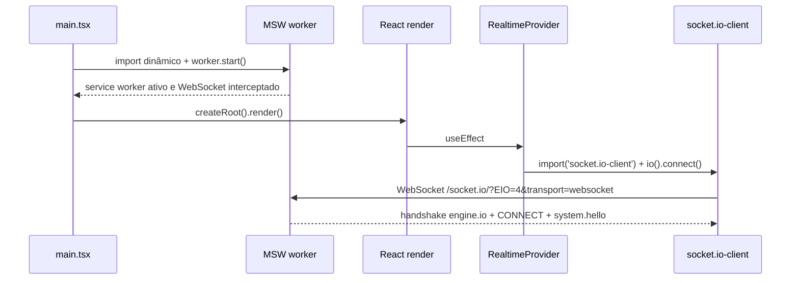

# Arquitetura — Kurio

Documento vivo: cada fase atualiza as seções que toca. Estado atual: **F1 (contratos, mocks e sessão)**, aguardando revisão.

## 1. Camadas e responsabilidades

- **`src/app`**: composição da aplicação. Variáveis de ambiente (`env.ts`), `QueryClient` com a política padrão de cache e retry (`query-client.ts`) e criação do router com contexto tipado (`router.ts`).
- **`src/routes`**: rotas file-based do TanStack Router. Devem ser finas: validação de search params, guards e ligação com as features. A árvore `src/routeTree.gen.ts` é gerada pelo plugin e versionada, para que `tsc -b` funcione num checkout limpo antes do build. As rotas privadas ficam sob o layout `_authenticated` (seção 12).
- **`src/contracts`**: schemas zod e tipos dos contratos, compartilhados por app, mocks e testes (seção 10).
- **`src/features`**: telas e lógica por domínio. `auth` (formulários, modal, página mobile, queries de sessão, guards e sanitização do redirect), `account` (perfil provisório), `demo` (painel de cenários) e `home`.
- **`src/shared/api`**: a instância Axios única (`http.ts`), o cliente da API de controle do mock e o modelo de erro (`errors.ts`).
- **`src/shared/session`**: o store da sessão, o vínculo com o `QueryClient`, as chaves de query privadas e os rascunhos por usuário.
- **`src/shared/realtime`**: o único lugar que conhece o `socket.io-client`.
- **`src/shared/forms`**, **`feedback`**, **`hooks`**, **`layout`**: campos de formulário, anunciador global (`role=status`), media query e páginas genéricas.
- **`src/lib`**: utilitários puros (`cn` configurado, aritmética de ETH em `bigint`).
- **`src/components/ui`**: componentes shadcn/ui, adaptados aos tokens do Kurio.
- **`src/mocks`**: MSW. Banco simulado (`db/`), handlers REST (`api/`), cenários de rede, servidor Socket.IO simulado e API de controle (`/__mock/*`). Nada fora daqui contém respostas fictícias.
- **`e2e`**: testes Playwright. Não importam código do app; as contas fictícias estão duplicadas em `e2e/support/auth.ts` de propósito.

**Fronteiras garantidas por lint** (`eslint.config.js`):
- `msw`, `@mswjs/*` e `@/mocks/*` não podem ser importados fora de `src/mocks`. A única entrada é o `import()` dinâmico no `main.tsx`, que o `no-restricted-imports` não analisa; essa exceção é deliberada e única. Em consequência, **o frontend nunca importa handlers nem o banco**.
- `socket.io-client` só pode ser importado em `src/shared/realtime`.
- `fetch` global é proibido fora de `src/mocks`; chamadas REST passam pelo Axios.
- O pacote `cn` só pode ser importado em `src/lib/utils.ts` (seção 6).

Essas regras foram testadas com arquivos de exemplo: os três casos proibidos geram erro, e o mesmo código em `src/mocks` passa.

## 2. Bootstrap

O `main.tsx` usa top-level await. A renderização só acontece depois do `worker.start()`, de modo que nenhuma requisição e nenhuma conexão escapam do mock. Antes de criar o router, o `main.tsx` chama `bindSessionToQueryClient(queryClient)` (seção 13); a árvore fica `QueryClientProvider` → `AnnouncerProvider` → `RealtimeProvider` → `RouterProvider`.

## 3. Tempo real: Socket.IO sobre MSW

**Transporte:** o app usa `socket.io-client` 4.8 com `transports: ['websocket']`. O MSW 2.15 intercepta o `WebSocket` dentro da página (não no service worker) com o handler `ws.link`. O `@mswjs/socket.io-binding` 0.2.0 traduz os pacotes engine.io e Socket.IO.

Três ajustes foram necessários. Todos foram descobertos e confirmados empiricamente na F0:

1. **O handler aponta para a origem, não para `/socket.io/`.** O MSW 2.15 remove o prefixo `/socket.io/` e a query da URL do cliente antes de comparar (`WebSocketHandler.parse`). Com `ws.link('ws://host/socket.io/')`, a URL real (`/socket.io/?EIO=4&transport=websocket`) não casava, e a conexão seguia para a rede, recebendo HTTP 200 do servidor estático. Uma expressão regular também não casa, porque a comparação é feita depois dessa limpeza. Isso foi confirmado executando o próprio `WebSocketHandler.test()` do MSW com as URLs candidatas.
2. **Heartbeat do engine.io.** O binding anuncia `pingInterval: 25000` e `pingTimeout: 5000` no handshake, mas nunca envia pings. O `socket.io-client` encerra a conexão por "ping timeout" após 30 s sem ping. O mock envia o pacote de ping (`2`) a cada 25 s. **Prova:** com o heartbeat desligado temporariamente, o teste de estabilidade registrou 3 conexões em 65 s, em vez de 1.
3. **`socket.io-client` carregado sob demanda.** O `engine.io-client` 6.6 guarda `globalThis.WebSocket` numa constante quando o módulo é avaliado (`transports/websocket.js`). Se ele fosse avaliado antes do `worker.start()`, usaria o `WebSocket` original, sem interceptação. O `createRealtimeSocket()` faz `import('socket.io-client')`, o que garante a ordem e tira a biblioteca do bundle inicial.

**Limitações conhecidas do transporte simulado.** As do binding foram confirmadas lendo o código instalado (`node_modules/@mswjs/socket.io-binding/src/index.ts`, versão 0.2.0):

- **Só WebSocket.** Long-polling HTTP do engine.io não é simulado.
- **Só o namespace padrão.** `emit` codifica sempre `nsp: '/'` (há um `@todo Support custom namespaces` no código), e o binding confirma o CONNECT com `40` (namespace `/`) por conta própria, num microtask, antes de ler qualquer pacote do cliente. Um cliente que pedisse `/orders` nunca seria confirmado nesse namespace.
- **Sem rooms nem broadcast.** São conceitos do servidor Socket.IO, que o binding não reimplementa. O mock só tem a lista de conexões que ele mesmo mantém (`activeConnections`).
- **Sem ACKs.** O listener recebe `(messageEvent, ...data)`, sem callback. Pacotes ACK do cliente são descartados, e o servidor não consegue responder com ACK.
- **ID de conexão fixo.** O handshake anuncia `sid: 'test'` no engine.io e no CONNECT, para todas as conexões. Assim, `socket.id` no cliente vale `'test'` sempre e não pode ser usado como identidade. O mock identifica conexões por `raw.client.id`, que o MSW gera de forma única.
- **Sem leitura do `auth`.** `on()` decodifica os pacotes, mas ignora tudo que não é EVENT. O pacote CONNECT, que carrega o `auth` do `io(url, { auth })`, nunca chega aos listeners. Como o binding confirma a conexão antes, também não há como recusá-la com CONNECT_ERROR (`44`) no fluxo nativo.

**Impacto no isolamento de usuários e no direcionamento de eventos.** Decidido e implementado na F1; veja a seção 14 (autenticação do socket). Em resumo: o mock mantém o mapa `conexão → userId`, lê o `auth` do pacote CONNECT bruto e recusa tokens inválidos com `44`. Sem ACKs, toda confirmação continua sendo um evento explícito de resposta, como em `system.ping`/`system.pong`.

**Outras limitações:**
- A interceptação existe só na aba atual. Cada aba tem seu próprio "servidor".
- O DevTools do navegador não mostra frames dessas conexões como WebSocket de rede, e o `page.on('websocket')` do Playwright não as vê. A verificação é feita pela UI e pela API de controle do mock. A ausência de WebSocket de rede é justamente a evidência de que a conexão foi interceptada.

**Contrato dos eventos** (`src/contracts/events.ts`): envelope `{ eventId, type, resource: { kind, id }, version, occurredAt, userId?, payload }`. Existem `system.hello` (servidor → cliente, depois de processar o CONNECT; payload `{ connectionId, userId | null }`), `system.ping` / `system.pong` (eco) e, desde a F1, `profile.updated` (privado, `userId` obrigatório, payload `AccountProfile` com `version`). `nft.updated` e `order.updated` já estão tipados para F2 e F4.

## 4. MSW no deploy

- O build de produção é a demonstração: `.env.production` define `VITE_ENABLE_MOCKS=true`.
- `public/mockServiceWorker.js` é gerado por `npx msw init public --save` e mantido na versão do pacote (`msw.workerDirectory` no `package.json`).
- A Vercel serve o worker com `Cache-Control: no-cache, no-store, must-revalidate`, para evitar que uma versão antiga fique registrada.
- A SPA usa rewrite de todas as rotas para `index.html`. Limitação: rotas inexistentes respondem HTTP 200 com o app, que então renderiza a página 404.
- **Custo de performance:** o chunk do MSW tem cerca de 465 kB (cerca de 172 kB gzip) e é carregado antes do primeiro render. Na sondagem de Lighthouse da F2 (seção 24), ele é o principal custo do perfil mobile.

## 5. Estado remoto e HTTP

- **Axios** (`src/shared/api/http.ts`): base `/api`, timeout de 10 s.
  - Request: adiciona `Authorization: Bearer <token>` e marca a requisição com a época da sessão; combina o `signal` do chamador com o da sessão (`AbortSignal.any`), de modo que trocar de sessão aborta tudo que estava em voo.
  - Response: se a época mudou enquanto a requisição viajava, a resposta é descartada com `SESSION_CHANGED`, mesmo que tenha chegado com sucesso.
  - Erros: todo erro vira `ApiError` (`src/shared/api/errors.ts`) com `code`, `status`, `message` em português e `fieldErrors`. Um 401 numa requisição feita com token, na mesma época, encerra a sessão como `expired`. 403, 409 e 422 chegam ao formulário com o código e os erros por campo.
  - `parseResponse(schema, data)` valida a resposta com o schema do contrato; resposta fora do contrato vira `UNEXPECTED_RESPONSE`.
  - `mockControlHttp`: instância separada para `/__mock`, sem token.
- **TanStack Query** (`src/app/query-client.ts`):
  - Queries: até 2 novas tentativas, só para erro de rede, timeout ou 5xx, com backoff exponencial limitado a 4 s; 4xx nunca é repetido.
  - `staleTime` padrão de 30 s; `refetchOnWindowFocus` desligado.
  - Mutations sem retry. A recuperação do pedido será feita com chave de idempotência (F4).

## 6. Estilo e design system

- **Tailwind CSS 4**, com configuração CSS-first: tokens do Figma no `@theme` de `src/index.css` (cores, escala tipográfica, sombras).
- **shadcn/ui** com base Radix, preset Nova. As variáveis semânticas (`--primary`, `--background`, ...) foram mapeadas para a paleta do Kurio. O app tem tema escuro único (`<html class="dark">`).
- O CLI 4.21 usa o pacote `cn` (mantido pelo shadcn) no lugar de `clsx` + `tailwind-merge`. **Problema encontrado na F1:** sem configuração, o merge lia `text-body-14` (tamanho) como cor e o descartava ao lado de `text-cream`; confirmado no Node (`cn('text-caption-13 text-cream')` → `'text-cream'`). **Correção:** `src/lib/utils.ts` cria o `cn` com `createCn` e registra a escala tipográfica do Kurio no grupo `font-size`; os componentes shadcn importam daí, e o lint proíbe importar `cn` direto do pacote.
- Token novo: `--color-border-field: #3f2319`, a borda dos campos e botões sociais dos modais de autenticação.
- **Fonte:** Roboto Mono 400/500/700, subset latin (que cobre os acentos do português), via `@fontsource/roboto-mono`. Os arquivos ficam no próprio bundle, sem requisição externa.

## 7. Testes

- Playwright com Chromium em dois projetos: `desktop` (1440×900) e `mobile` (Pixel 7, 390×844).
- Sem retries automáticos (`retries: 0`), para não esconder instabilidade. Traces ficam em `retain-on-failure` e o relatório HTML em `playwright-report/`.
- Os testes chamam a API de controle de dentro da página (`fetch` no contexto do navegador). A requisição passa pelo service worker do MSW, como qualquer requisição do app. Não há `page.route`.
- **Teste pulado de propósito:** `deployed build matches the expected commit` só roda quando `EXPECTED_COMMIT_SHA` está definido. No build local, o SHA embutido é sempre `local`, porque `VERCEL_GIT_COMMIT_SHA` só existe na Vercel. Por isso o teste só tem sentido contra o deploy, com `npm run test:e2e:deploy`. Localmente e no CI, ele aparece como 2 pulados (um por projeto).
- **Arquivos (F1):** `smoke` (rotas públicas, guard das privadas, MSW e socket anônimo), `realtime-poc` (F0), `auth` (cadastro, login, logout, expiração, retorno à rota, open redirect, proteção de rotas), `isolation` (troca A→B sem refresh, vazamento em storage, resposta atrasada, socket e eventos), `mocks` (reset, persistência, senha ausente, falhas de API e de storage).
- **Arquivos (F2):** `catalog` (busca, filtros combinados, ordenação, paginação, URL com voltar/avançar/refresh, parâmetros inválidos, respostas fora de ordem), `nft-detail` (acesso direto, NFT inexistente, edições e quantidade, abas por teclado, carrosséis), `favorites` (favoritar e desfazer, visitante, rollback, mudanças concorrentes com uma falha atrasada, NFT travado enquanto a mudança está pendente, troca de usuário com mudança pendente, isolamento A/B, API sem sessão, estados da lista), `loading-states` (skeleton, vazio, erro e nova tentativa), `realtime-nft` (`nft.updated`, duplicado e antigo, socket bloqueado e reconciliação, três trocas de usuário seguidas) e `responsive-a11y` (larguras, axe, teclado, movimento reduzido).
- **Esperas sem tempo fixo (F2):** o Playwright não enxerga requisições respondidas pelo service worker do MSW (`waitForResponse` não dispara). Em vez de pausas, o mock expõe `GET /__mock/network/activity` (requisições `/api/*` em andamento e contagem por `MÉTODO /caminho?query`) e `refusedWhileBlocked` em `GET /__mock/socket/connections`. Os testes esperam "o mock respondeu tudo", "o servidor bloqueado recusou N reconexões" ou "nenhuma leitura REST de preço foi feita", com `expect.poll` e timeout explícito. A única pausa fixa que resta é a da F0 (`realtime-poc`, 65 s), que mede justamente a estabilidade da conexão ao longo do tempo.
- **Arquivos (F3):** `cart` (adicionar, quantidade e limites, remoção até o vazio, KURIO10, cupom inexistente e expirado, remoção do cupom, refresh, junção no login, ajustes na junção, precisão 0.1 × 3, tela igual à resposta de `POST /quotes`, carregamento/erro/nova tentativa, badge, e com o carrinho aberto: mudança de preço e fim do estoque por `nft.updated`). `realtime-nft` ganhou o caso do carrinho com socket bloqueado, reconciliação na reconexão, evento duplicado e evento antigo. `nft-detail` passou a verificar que "Comprar" põe a seleção no carrinho.
- Cada teste roda num contexto de navegador novo: `localStorage` próprio, portanto banco simulado próprio. Não há estado compartilhado entre testes.
- **CI** (`.github/workflows/ci.yml`): Node 24, `npm ci`, `npm run verify`, Chromium do Playwright com dependências do sistema e `npx playwright test` com a suíte completa, sem filtro de tags. O relatório HTML e os traces sobem como artefato, mesmo quando os testes falham (`if: !cancelled()`). O workflow não usa secrets.

## 8. Decisões

Cada item segue o formato: problema, escolha, alternativa descartada e motivo.

- **D1, versão do MSW:** o MSW 3.0.3 é o estável atual, mas o `@mswjs/socket.io-binding` 0.2.0 exige `msw ^2.10.2`. **Escolha:** MSW 2.15.0, a última 2.x. **Descartado:** MSW 3 com override de peer, porque o MSW 3 renomeou o evento `connection` e o binding não foi atualizado.
- **D2, match do handler Socket.IO:** **escolha:** `ws.link(origem)`, seguindo o comportamento do MSW para `/socket.io/`. **Descartado:** escrever um adaptador próprio, desnecessário depois que a causa foi encontrada.
- **D3, heartbeat no mock:** **escolha:** pings engine.io a cada 25 s no handler. **Descartado:** anunciar um `pingInterval` enorme, que exigiria reescrever o handshake do binding e esconderia o comportamento real do protocolo.
- **D4, import dinâmico do `socket.io-client`:** **escolha:** carregar sob demanda no módulo de tempo real. **Descartado:** carregar o app inteiro dinamicamente depois do MSW, o que somaria uma cascata de requisições ao carregamento inicial.
- **D5, `routeTree.gen.ts` versionado:** permite typecheck num checkout limpo sem rodar o plugin antes. **Descartado:** adicionar `@tanstack/router-cli` só para gerar o arquivo.
- **D6, `shadcn` em `devDependencies`:** o pacote só fornece o CLI e o `shadcn/tailwind.css`, um arquivo CSS resolvido no build, sem executar JavaScript do pacote. Com isso, `npm audit --omit=dev` fica com 0 vulnerabilidades. Isso **não** significa que o projeto está sem vulnerabilidades; veja a seção 9.
- **D7, sem retries no Playwright:** um teste instável deve ser corrigido na causa, não mascarado.
- **D8, zod para os contratos:** um schema serve de tipo, de validação no handler, de validação no formulário e de checagem da resposta no cliente. **Descartado:** tipos TypeScript soltos, que não validam nada em tempo de execução e deixariam handler e formulário divergirem.
- **D9, token opaco em vez de JWT:** o mock guarda só o SHA-256 do token e pode revogar a sessão no logout. **Descartado:** JWT assinado no navegador, porque a chave de assinatura ficaria no bundle e a assinatura não provaria nada.
- **D10, autenticação do socket pelo `auth` do CONNECT:** detalhes na seção 14. **Descartado:** token na query da URL.
- **D11, navegação imperativa ao perder a sessão:** o layout protegido navega num `useEffect` disparado uma vez por mudança de época. **Descartado:** o componente `<Navigate>`. Ele navega de novo a cada render com props novas e, enquanto a rota protegida continua montada durante a transição, isso virou um laço que travou a thread principal (o `page.evaluate` do Playwright não retornava). Reproduzido e corrigido na F1.
- **D12, modal de autenticação realmente modal:** no desktop, o modal prende o foco e torna o resto da página inerte, como pede o padrão de diálogo acessível. Consequência: o painel da demonstração fica inacessível com o modal aberto; para usá-lo, fecha-se o modal (X ou Esc). **Descartado:** `modal={false}`, que tiraria o foco preso só para facilitar a demonstração.
- **D13, estado do catálogo só na URL (F2):** **escolha:** search params validados pela rota, sem store de filtros. **Descartado:** um store (Zustand ou contexto) sincronizado com a URL, que cria duas fontes de verdade e quebra voltar/avançar quando elas divergem.
- **D14, respostas fora de ordem pelo cache (F2):** **escolha:** uma chave de query por combinação de parâmetros. **Descartado:** contador de requisição ou `AbortController` manual, que reimplementam o que o TanStack Query já garante por chave.
- **D15, rollback por item no favorito (F2):** **escolha:** desfazer só a mudança do NFT que falhou. **Descartado:** restaurar o retrato da lista tirado no `onMutate`, que apagaria outros favoritos clicados enquanto a requisição viajava.
- **D16, versão no evento (F2):** **escolha:** aplicar `nft.updated` só com `version` maior que a do cache, além da deduplicação por `eventId`. **Descartado:** confiar só no `eventId`, que não protege contra um evento antigo reenviado com id novo.
- **D17, reconciliação ao reconectar (F2):** **escolha:** depois de uma queda, refazer as queries públicas marcadas com `meta.reconcileOnReconnect`. **Descartado:** polling periódico, que traria o preço "por outro caminho" mesmo com o socket ativo e esconderia falhas do tempo real.
- **D18, recusa de conexão do socket bloqueado (F2, revisão):** **problema:** só fechar o WebSocket deixava o `socket.io-client` esperando o timeout de 20 s; a primeira solução disparava `error` no WebSocket da página por `raw.client.socket`, uma propriedade que existe na classe do `@mswjs/interceptors` 0.39 (MSW 2.15), mas não no tipo público do MSW. **Escolha:** responder com um frame que não é pacote engine.io válido (`x`), pela API pública `client.send`. O `engine.io-parser` 5 o decodifica como pacote de erro, e o `engine.io-client` 6 falha a tentativa na hora; o `socket.io-client` emite `connect_error` e tenta de novo com backoff, como diante de um servidor inalcançável. **Descartado:** a propriedade interna do MSW, que pode sumir numa atualização sem erro de tipo; e responder `CONNECT_ERROR` do Socket.IO, que o cliente trata como recusa definitiva e não reconecta. A dependência restante é o protocolo engine.io (estável desde a v4) e está isolada em `refuseConnection` (`src/mocks/socket.ts`).
- **D19, uma mudança de favorito por NFT (F2, revisão):** **problema:** o botão bloqueava só a si mesmo (`isPending` da própria instância); ao abrir o detalhe com a requisição do card em voo, um segundo clique começava outra mudança do mesmo NFT, e o rollback atrasado da primeira podia desfazer a segunda. **Escolha:** todo botão do NFT fica `aria-disabled` enquanto houver mutation pendente para ele (`useIsMutating` filtrado pelo NFT e pelo usuário), e o rollback só acontece se a mutation que falhou ainda é a mais recente daquele NFT. **Descartado:** uma fila de mutations por NFT (`scope`), que esconderia do usuário que a mudança anterior ainda está pendente.
- **D20, carrinho do visitante no servidor (F3):** **problema:** o visitante precisa de carrinho persistente sem conta, e a junção no login precisa de uma fonte de verdade. **Escolha:** o carrinho vive no servidor simulado, identificado por um id aleatório (`gc_<uuid>`) que o navegador envia em `X-Cart-Id`; o id só é criado na primeira adição. **Descartado:** carrinho só no `localStorage`, que deixaria preço, estoque e cupom sob controle do cliente e faria da junção uma cópia sem validação.
- **D21, revisão do carrinho e cotação por revisão (F3):** **problema:** um total calculado para itens que já mudaram não pode aparecer como atual. **Escolha:** toda mudança do carrinho incrementa `revision`; `POST /quotes` recebe `{ cartRevision }` e responde 409 `CART_CHANGED` se o carrinho do servidor estiver em outra revisão; no cliente a cotação é uma query por revisão, sem dados anteriores como placeholder. **Descartado:** calcular o total no cliente (duplicaria a regra de dinheiro) ou mostrar a cotação anterior enquanto a nova carrega (mostraria um valor velho como se fosse o atual).
- **D22, reconciliação no servidor (F3):** **problema:** preço e estoque mudam com o carrinho guardado. **Escolha:** toda leitura ou escrita do carrinho, a cotação e a junção reconciliam com o catálogo (remove esgotado, reduz quantidade, atualiza preço, retira cupom vencido) e gravam um aviso para cada ajuste. **Descartado:** ajustar no cliente ao receber `nft.updated`, que só funcionaria com a aba aberta e conectada.
- **D23, junção idempotente (F3):** **escolha:** `POST /api/cart/merge` soma as quantidades da mesma edição, limita ao máximo atual e apaga o carrinho do visitante na mesma transação; o cliente só esquece o id depois da resposta. Repetir a chamada (nova tentativa, refresh, outra aba) não soma nada outra vez. O id juntado fica registrado (`mergedGuestCarts`, os 200 mais recentes); uma escrita de visitante que chegue depois com esse id recebe 409 `CART_MERGED` em vez de recriar um carrinho órfão. No cliente a junção é uma promessa única por conta e id (`mergePendingGuestCart`), fora do ciclo de vida da query: um `cancelQueries` rejeita a leitura, mas não a junção, e a próxima leitura reaproveita a mesma promessa. Antes de juntar, o cliente espera as escritas de visitante em voo; essas escritas não são abortadas pela troca de sessão (`keepOnSessionChange`) e a resposta tardia vira `SESSION_CHANGED`, sem tocar no cache. Mudanças do carrinho da conta esperam a junção pendente. **Descartado:** juntar no cliente com várias chamadas de adição, que duplicaria itens se uma resposta se perdesse; tirar o `cancelQueries` das mudanças, que deixaria leituras velhas sobrescreverem a resposta.

## 9. Resultados da F0

Execuções locais em 15/10/2026, Node 24.12, Chromium headless shell 156 (Playwright 1.64.1):

- `npm ci`: passou, sem alterar o `package-lock.json`.
- `npm run verify` (typecheck, lint, build): passou.
- `npm ci` + `npm run verify` numa cópia limpa do projeto, sem `node_modules`: passou.
- `npx playwright test`, suíte completa, desktop + mobile: **38 aprovados, 2 pulados, 0 falhas** (1,3 min). Os 2 pulados são o teste de versão do deploy (seção 7).
- `npm audit --omit=dev`: 0 vulnerabilidades nas dependências de produção.
- `npm audit` completo: **7 de severidade alta, todas só em desenvolvimento.** A origem é `braces@3.0.3` (GHSA-vfj7-8cjw-p6xm: negação de serviço por estouro de pilha com padrões glob muito aninhados), pela cadeia `shadcn` → (`@shadcn/registry`, `ts-morph` → `@ts-morph/common`) → `fast-glob` → `micromatch` → `braces`. O lockfile marca o `braces` como `dev: true`. Não há correção compatível: o advisory não tem versão corrigida, e o `npm audit fix --force` rebaixaria o `shadcn` para 1.0.0, incompatível com Tailwind 4. Impacto conhecido: só ao rodar o CLI do shadcn localmente com padrões glob de origem não confiável. Nada disso chega ao bundle, e o CI não executa o CLI. Vale reavaliar quando sair uma versão do shadcn com a cadeia atualizada.
- Prova de conceito do Socket.IO, local (desktop e mobile):
  - Evento recebido do mock, sem nenhum WebSocket de rede real visto pelo Playwright: passou. Quando o handler não casava, o Playwright registrava o WebSocket real; essa asserção prova que o worker interceptou a conexão.
  - Conexão estável por 65 s (1 conexão, 0 quedas): passou.
  - Reconexão após encerramento pelo servidor (motivo `transport close`, nova conexão, novo `system.hello`): passou.
- **Deploy na Vercel** ([nft-marketplace-iota-three.vercel.app](https://nft-marketplace-iota-three.vercel.app/)), commit `eac2426`. Comando: `npm run test:e2e:deploy` com `EXPECTED_COMMIT_SHA` definido.
  - Resultado: **40 aprovados, 0 falhas, 0 pulados** (1,2 min), desktop e mobile. Inclui a prova de conceito completa (estabilidade por 65 s e reconexão) e a checagem de que o build publicado é o commit esperado.
  - Conferido com `curl`: `mockServiceWorker.js` sai com `Cache-Control: no-cache, no-store, must-revalidate` e `Service-Worker-Allowed: /`, e rotas profundas respondem 200 pelo rewrite.
- **CI no GitHub** ([execução 38743865559](https://github.com/Henriqueverri/nft-marketplace/actions/runs/38743865559)), commit `eac2426`: sucesso em 2 min 38 s. Todas as etapas passaram, e o Playwright teve **38 aprovados e 2 pulados** (a checagem do commit do deploy, que precisa de `EXPECTED_COMMIT_SHA`).

## 10. Contratos e erros (F1)

Os schemas ficam em `src/contracts`, um arquivo por domínio: `common` (ids, datas ISO, valores em ETH como string decimal), `errors`, `account` (perfil público, conta e perfil privado), `auth` (cadastro, login, sessão), `catalog` (redes, coleções, edições e NFTs; usados pelo seed agora, endpoints na F2), `wallets`, `pagination` (`paginatedSchema(item)`, a partir da F2), `mock` (cenário e estado do mock) e `events`.

**Formato único de erro:** `{ "error": { "code", "message", "fieldErrors"? } }`. O código determina o status HTTP (`API_ERROR_STATUS`):

| Código | HTTP |
| --- | --- |
| `VALIDATION_FAILED` | 422 |
| `INVALID_CREDENTIALS`, `UNAUTHENTICATED`, `SESSION_EXPIRED` | 401 |
| `FORBIDDEN` | 403 |
| `NOT_FOUND` | 404 |
| `EMAIL_TAKEN`, `USERNAME_TAKEN`, `CONFLICT` | 409 |
| `QUANTITY_LIMIT_EXCEEDED`, `OUT_OF_STOCK`, `CART_CHANGED` (F3) | 409 |
| `COUPON_INVALID`, `COUPON_EXPIRED` (F3) | 422 |
| `STORAGE_CORRUPTED`, `INTERNAL_ERROR` | 500 |
| `SERVICE_UNAVAILABLE` | 503 |
| `STORAGE_FULL` | 507 |

O cliente acrescenta códigos que não vêm do servidor: `NETWORK_ERROR`, `TIMEOUT`, `CANCELED`, `SESSION_CHANGED` e `UNEXPECTED_RESPONSE`.

**O que nunca sai numa resposta:** hash ou salt de senha, a própria senha, tokens de outras sessões. O token da sessão aparece uma única vez, na resposta de cadastro ou login. `GET /__mock/state` também não expõe credenciais nem tokens; um teste confere isso.

**Endpoints REST (MSW)**, todos sob o cenário de rede (seção 15):

| Método e rota | Sucesso | Erros principais |
| --- | --- | --- |
| `POST /api/auth/signup` | 201 `AuthSession` | 422, 409 `EMAIL_TAKEN`/`USERNAME_TAKEN` com `fieldErrors` |
| `POST /api/auth/login` | 200 `AuthSession` | 422, 401 `INVALID_CREDENTIALS` |
| `GET /api/auth/session` | 200 `CurrentSession` | 401 `UNAUTHENTICATED`/`SESSION_EXPIRED` |
| `POST /api/auth/logout` | 204 | 401 |
| `GET /api/account/profile` | 200 `AccountProfile` | 401 |
| `PATCH /api/account/profile` | 200 `AccountProfile` + evento `profile.updated` | 401, 422 |

Os handlers derivam o usuário **somente do token**; nenhuma rota aceita `userId` do cliente. Conflitos de cadastro são checados de novo dentro da transação, porque o hash da senha é assíncrono e outra aba pode ter criado a conta nesse intervalo.

## 11. Banco simulado e persistência (F1)

Responsabilidades separadas em `src/mocks/db/`:

- `seed.ts`: dados determinísticos (PRNG mulberry32 com semente fixa): 2 contas fictícias, 48 NFTs (os 9 primeiros vêm do Figma), coleções, redes e carteiras. Preços calculados em `bigint` (wei), sem ponto flutuante.
- `schema.ts`: o schema zod do estado persistido.
- `integrity.ts`: regras que o schema não expressa (ids, e-mails e usernames únicos, e-mail normalizado, uma credencial por usuário, sessões e carteiras apontando para usuários existentes, preço igual à edição mais barata, `available ≤ supply`).
- `storage.ts`: leitura e escrita no `localStorage` (`kurio:mock-db:v1`), com erros explícitos.
- `database.ts`: carga preguiçosa, `readDb()`, `transaction(mutate)` e `resetDb()`.

**Escrita transacional:** a transação clona o estado, aplica a mudança, valida o schema e a integridade, grava e só então troca a cópia em memória. Se qualquer passo falha, nada muda.

**Falhas de armazenamento nunca viram sucesso falso:**
- Cota cheia (`QuotaExceededError`) → `StorageFullError` → 507 `STORAGE_FULL`. O cadastro falha, a conta não é criada e a sessão não começa (teste com o `localStorage` preenchido até a cota).
- JSON inválido ou integridade quebrada na carga → 500 `STORAGE_CORRUPTED` em toda rota até o reset. O banco **não** é recriado em silêncio, para não apagar dados sem aviso. O painel mostra "corrompido".
- Versão de seed antiga → o banco é recriado a partir do seed novo.
- Um evento `storage` de outra aba invalida a cópia em memória.

**Senhas.** PBKDF2-SHA-256 via Web Crypto, **600.000 iterações** (recomendação OWASP para PBKDF2-SHA-256), salt aleatório de 16 bytes por senha, chave de 256 bits e comparação em tempo constante. Custo medido: cerca de 110 ms por hash no Chromium local. Para e-mail inexistente, o login compara com um hash fictício: mesma mensagem e tempo semelhante, para não revelar quais e-mails existem.

**Sessões.** Token opaco de 32 bytes aleatórios (base64url). O banco guarda só o SHA-256 do token; vazar o banco não vaza sessões utilizáveis. Validade de 8 h; logout revoga.

> **Isto é autenticação simulada.** Senha e banco ficam no navegador do próprio usuário, e qualquer script da página pode ler o `localStorage`. As medidas acima evitam guardar segredos em claro e reproduzem o comportamento esperado de um backend, mas **não equivalem à segurança de um servidor**. Em produção, hash e sessões ficariam no backend, e o token, num cookie `httpOnly` e `SameSite`.

## 12. Autenticação, sessão e rotas (F1)

- **Store da sessão** (`src/shared/session/session-store.ts`): `{ token, userId, epoch, endReason }`, persistido em `kurio:session`. A **época** muda em todo login, logout, expiração, reset ou troca de conta em outra aba. `start()` grava primeiro: se o storage falhar, a sessão não começa.
- **Queries de sessão** (`src/features/auth/queries.ts`): `['session']` pergunta à API quem é o usuário; sem token, nem pergunta. Login e cadastro iniciam a sessão e já gravam o usuário no cache.
- **Layout `_authenticated`** (`src/routes/_authenticated.tsx`): o `beforeLoad` confere a sessão na API (`fetchQuery`, que respeita `staleTime` e refaz se a query foi invalidada). Sem sessão, redireciona para `/login?redirect=<rota>` e acrescenta `reason=expired` quando foi expiração. Se a checagem falha por rede ou servidor, mostra um erro com "Tentar novamente". Quando a sessão acaba com o usuário já numa tela privada, o componente navega para `/login` (expiração) ou `/` (logout, reset) (D11).
- **Rotas privadas:** `/account/profile`, `/account/wallets`, `/account/favorites`, `/checkout` e `/orders/$orderId`. O carrinho continua público (visitante).
- **`/login` e `/signup`:** usuários já autenticados são mandados para o `redirect`. Se a checagem de sessão falha, o formulário continua disponível.
- **Redirect sem open redirect** (`src/features/auth/redirect.ts`): só caminhos relativos da mesma origem. `//host`, URLs absolutas, barra invertida e as próprias páginas de auth viram `/`. Testado com `//evil.example/roubo`, `https://evil.example` e `/\evil.example`.
- **Expiração:** o cenário `POST /__mock/session/expire` faz a sessão vencer no banco; a próxima requisição privada recebe um 401 real, o cliente encerra a sessão como `expired`, limpa o cache e leva ao login com o retorno preservado.
- **Rascunhos** (`src/shared/session/drafts.ts`): `sessionStorage`, chave `kurio:draft:<userId>:<nome>`. Expiração mantém o rascunho (o usuário retoma depois de entrar de novo); logout apaga os do usuário que saiu. Um rascunho só é lido para o mesmo `userId`.
- **Logout:** chama a API (revoga a sessão e fecha os sockets dela no servidor) e, mesmo se a chamada falhar, encerra a sessão local. Em seguida navega para `/` e anuncia "Você saiu da sua conta."

## 13. Isolamento entre sessões (F1)

Camadas independentes; cada uma sozinha já impede o vazamento mais comum:

1. **Servidor:** o usuário vem só do token. Não há rota que aceite `userId` do cliente.
2. **Chaves de query:** dados privados usam `['user', userId, ...]` (`privateQueryKey`).
3. **Limpeza síncrona:** `bindSessionToQueryClient` assina o store. Em qualquer troca de sessão, cancela as queries, apaga o cache de queries e as mutations já resolvidas (as variáveis podem conter dados privados), antes de qualquer render com a nova sessão. A mutation de login em andamento é preservada.
4. **Respostas atrasadas:** a época aborta as requisições em voo e descarta respostas que chegam depois da troca (`SESSION_CHANGED`). Testado com duas abas: a resposta de Ana, atrasada 2 s, chega depois que a outra aba trocou a sessão para Bruno, e o e-mail de Ana nunca aparece (observado por `MutationObserver`).
5. **Socket:** um socket por época, criado com `forceNew`; nunca se reaproveita a conexão de A para B (seção 14).
6. **Eventos:** o cliente descarta eventos privados cujo `userId` não é o da sessão atual e duplicatas por `eventId` (LRU de 500). O perfil só aplica uma atualização com `version` mais nova.
7. **Persistência local:** só o banco simulado (o "servidor") e o cenário ficam no `localStorage` depois do logout; o token sai, e os rascunhos do usuário são apagados.

O teste eliminatório (`isolation.spec.ts`) faz A entrar, alterar o perfil, deixar um rascunho e sair; B entra **sem refresh** (um marcador em `window` prova que o documento é o mesmo) e não vê e-mail, nome, rascunho nem username de A.

## 14. Autenticação do socket (F1)

**Leitura do binding** (0.2.0): ele confirma o CONNECT com `40{"sid":"test"}` por conta própria, num microtask, antes de ler o pacote do cliente, e só decodifica pacotes EVENT. O `auth` do `io(url, { auth })` nunca chega aos listeners do binding.

**Escolha:** o cliente envia o token no `auth` do CONNECT (`io(url, { auth: { token }, forceNew: true, transports: ['websocket'] })`). O token viaja dentro de um frame WebSocket, não na URL. O mock escuta a mensagem bruta do cliente (`raw.client.addEventListener('message')`), decodifica o `40{...}`, valida o token com a mesma função dos handlers REST e associa `userId` e `sessionId` à conexão, identificada pelo `raw.client.id` do MSW (nunca por `socket.id`, que é sempre `"test"`).

- Token inválido, sessão vencida ou namespace customizado: o mock envia `44{"message":"UNAUTHENTICATED"}` (CONNECT_ERROR). O `socket.io-client` destrói o socket e emite `connect_error`; o painel mostra "recusado", e o cliente pede à API REST que confirme a sessão. **Evidência:** teste com token forjado em nome de Ana e REST atrasado 3 s: o painel mostra "recusado" antes do 401 do REST, a identidade de Ana nunca aparece e nenhuma conexão fica associada a um usuário.
- Entre o `40` automático do binding e a validação, a conexão existe sem dono. Nesse intervalo o mock não envia nenhum evento privado, porque eventos privados só vão para conexões com dono (`emitToUser`) e sessão ativa.
- `system.hello` só sai depois da validação e informa `{ connectionId, userId }`.
- Uma recusa também desfaz uma associação anterior: se uma conexão já autenticada envia outro CONNECT com token inválido, ela volta a não ter dono.
- Logout fecha no servidor as conexões daquela sessão; reset fecha todas. No cliente, a limpeza do effect remove os listeners (`removeAllListeners`, `offAny`) antes do `disconnect`, e o socket seguinte é anônimo. Teste: depois do logout há uma conexão, com `userId: null`, as inscrições caem a 0 e um evento para Ana é entregue a 0 conexões.

**Descartado: token na query da URL do handshake.** Seria mais simples no mock (a URL chega no evento `connection`), mas URLs aparecem em logs de servidor e proxy, no histórico de ferramentas de rede e em cabeçalhos `Referer`; o token vazaria por canais que não são feitos para segredos. Além disso, um servidor Socket.IO real lê o `auth` nativamente, então a escolha atual não exige mudança no cliente quando o mock for trocado.

## 15. Painel de cenários e API de controle (F1)

O painel (`src/features/demo/DemoPanel.tsx`) substitui a barra de diagnóstico da F0, mantendo os mesmos `data-testid`. Mostra sessão, estado e identidade do socket, conexões, quedas, eventos aplicados e ignorados, inscrições, versão, cenário atual, estado do armazenamento, número de usuários e de sessões ativas. Controles: latência, falha da API, "Expirar sessão" e "Restaurar estado inicial".

Ele usa só a API de controle, via `mockControlHttp`; nunca toca o banco. A API existe apenas com `VITE_ENABLE_MOCKS=true`:

| Rota | Efeito |
| --- | --- |
| `GET /__mock/status` | mock ativo e número de conexões |
| `GET /__mock/state` | resumo sem segredos; funciona com o banco corrompido |
| `GET`/`PUT /__mock/scenario` | `{ latencyMs: 0..10000, failure: none \| server-error \| unavailable \| offline, realtimeClient?: available \| unavailable }`, persistido em `kurio:mock-scenario:v1` |
| `POST /__mock/reset` | seed, cenário padrão, fechamento de todos os sockets; a partir da F2 também desbloqueia o socket e limpa atrasos, o registro de requisições e eventos reenviáveis |
| `POST /__mock/session/expire` | vence as sessões ativas (opcional `{ userId }`) |
| `POST /__mock/socket/disconnect` | fecha todos os sockets |
| `GET /__mock/socket/connections` | conexões e seus donos; `refusedWhileBlocked`: tentativas recusadas desde o último bloqueio (F2) |
| `POST /__mock/users/:userId/profile` | muda o nome no banco e emite `profile.updated` para o dono ou para todos (`delivery: broadcast`, simula um bug de roteamento) |
| `POST /__mock/socket/block` | `{ blocked }`: com `true`, derruba as conexões e recusa as novas, como um servidor inalcançável (F2) |
| `POST /__mock/network/delays` | `{ pathPrefix, method?, delaysMs[], failure? }`: atrasos de uso único para as próximas requisições do prefixo (e do método), para entregar respostas fora de ordem; com `failure`, essas requisições também falham, independentemente do cenário (F2) |
| `GET /__mock/network/activity` | `{ inFlight, requests }`: requisições `/api/*` em andamento e contagem por `MÉTODO /caminho?query` desde o último reset, para os testes esperarem sem tempo fixo (F2) |
| `POST /__mock/nfts/:nftId/update` | `{ priceEth?, available? }`: muda preço ou estoque no banco e emite `nft.updated` para todos (F2) |
| `POST /__mock/nfts/:nftId/replay` | `{ kind: duplicate \| stale }`: reenvia o último evento (mesmo `eventId`) ou o anterior com `eventId` novo (F2) |
| `GET /__mock/users/:userId/favorites` | ids favoritados de um usuário, para conferir isolamento de fora do app (F2) |
| `GET /__mock/carts` | todos os carrinhos persistidos (contas e visitantes): revisão, cupom, linhas e tipos de aviso, para conferir o servidor de fora do app (F3) |
| `GET /__mock/quotes/:quoteId` | a cotação exatamente como `POST /api/quotes` a respondeu (as 50 últimas ficam em memória), para comparar a tela com a resposta real (F3) |

O cenário de rede vale só para `/api/*`; a API de controle nunca sofre atraso nem falha. `offline` responde com erro de rede (`HttpResponse.error()`).

**Falha ao carregar o cliente de tempo real.** O `socket.io-client` é carregado sob demanda a partir de `src/shared/realtime/socket-client.ts`, o que dá ao chunk um nome estável (`socket-client-<hash>.js`). Com `realtimeClient: 'unavailable'`, um handler do MSW (`src/mocks/assets.ts`) responde a esse chunk com erro de rede, como aconteceria depois de um deploy que removeu o chunk antigo; os demais arquivos estáticos seguem para a rede. A falha é do próprio `import()` do app, sem `page.route` e sem substituir o código real. O provider captura a rejeição e entra no estado `unavailable` ("indisponível" no painel): não há socket, os contadores ficam em zero e nada indica conexão. Um aviso `role=alert`, sem detalhes internos, explica que as atualizações automáticas estão indisponíveis e oferece "Tentar conectar novamente", que reinicia a tentativa (o estado é marcado por época da sessão e por tentativa). O Chromium refaz o `import()` depois de uma falha; o teste confirma a recuperação.

## 16. Telas de autenticação (F1)

Seguem os frames "Desktop / Login", "Desktop / Cadastro", "Mobile / Login" e "Mobile / Cadastro".

- **Desktop (≥ 768 px):** modal sobre a home, 500 px de largura, a 160 px do topo, abas "Entrar | Criar conta" como links de rota, barra laranja de 10 px na base e fundo sem escurecimento (o fundo do frame no Figma não tem preenchimento). Os valores literais do Figma foram mantidos, inclusive a inconsistência de raio (login 0, cadastro 8 px).
- **Mobile:** página própria, com logo "KURIO", sem o header provisório; campos de 50 px e botão de 60 px com raio 10. O placeholder centralizado do nome de usuário no cadastro mobile também é literal do Figma.
- **Acessibilidade:** o Figma usa só placeholders; cada campo tem um `label` visualmente oculto. Erros ficam em `aria-describedby`, com `aria-invalid` e foco no primeiro campo inválido. Erros gerais usam `role=alert`. O título do modal é um `h1` oculto. O foco inicial vai para o primeiro campo. Texto de erro em coral `#f0805f`, que contrasta melhor no fundo escuro que o vermelho `#ed1b2e` do Figma.
- **Fora do escopo da demonstração:** login social e "Esqueceu a senha?" mantêm a composição do Figma, mas avisam "indisponível na demonstração" num `role=status`, em vez de fingir que funcionam.
- **Substituição documentada:** o ícone de "mostrar senha" é o `Eye` do lucide, porque o Figma só tem o ícone de senha oculta (exportado de lá, junto com os ícones de Google, Facebook e fechar, por `scripts/export-figma-assets.mjs`).
- **Perfil provisório:** `/account/profile` já lê e altera dados privados reais (nome de exibição, com rascunho por usuário), porque os testes de isolamento dependem disso. A tela do Figma entra na F5.

## 17. Resultados da F1

Execuções locais em 15/10/2026, mesmo ambiente da F0:

- `npm run verify` (typecheck, lint, build): passou.
- `npx playwright test`, suíte completa (desktop + mobile, incluindo o teste de 65 s da F0): **90 aprovados, 2 pulados, 0 falhas** (2,2 min). Os 2 pulados continuam sendo a checagem do commit do deploy (seção 7). Por arquivo, contando os dois projetos: smoke 34, auth 24, mocks 14, isolation 12, realtime-poc 8 (inclui a falha de carregamento do cliente de tempo real).
- Bundle: o chunk inicial do app tem 238 kB (75 kB gzip); o zod entra num chunk compartilhado de 53 kB (20 kB gzip); o cliente de tempo real, carregado sob demanda, tem 31 kB (10 kB gzip). O chunk do MSW continua com cerca de 454 kB (169 kB gzip).
- **Validação remota pendente:** CI no GitHub e deploy na Vercel desta fase dependem do push.

## 18. Catálogo, contratos e API (F2)

**Contratos** (`src/contracts/catalog.ts`, `favorites.ts`, `events.ts`, `mock.ts`): o NFT ganhou `attributes`, `popularity`, `contractAddress` e `royaltyPercent`; o detalhe acrescenta coleção, rede e `rating { average, count }`. A listagem é `nftListQuerySchema` (busca até 60 caracteres, coleções, redes, preço mínimo e máximo, visão `all | new | trending`, ordenação `recent | price-asc | price-desc | name`, página de 9 itens) e responde página + facetas. O evento `nft.updated` leva o novo `priceEth`, `compareAtPriceEth` e preço e estoque de cada edição, com `version` no envelope.

| Método e rota | Sucesso | Erros principais |
| --- | --- | --- |
| `GET /api/nfts` | 200 página + facetas | 422 (`minPrice > maxPrice`, parâmetro inválido) |
| `GET /api/nfts/featured` | 200 `{ slides, spotlight }` | — |
| `GET /api/nfts/:nftId` | 200 `NftDetail` | 404 "NFT não encontrado." |
| `GET /api/nfts/:nftId/related` | 200 `{ items }` (mesma coleção, até 8) | 404 |
| `GET /api/nfts/:nftId/recommendations` | 200 `{ items }` | 404 |
| `GET /api/nfts/:nftId/reviews` | 200 `{ items }`, mais recentes primeiro | 404 |
| `GET /api/account/favorites` | 200 `{ items }` | 401 |
| `PUT`/`DELETE /api/account/favorites/:nftId` | 200 / 204, idempotentes | 401, 404 |

- A busca ignora acentos e caixa e procura em nome, coleção, criador e atributos. Cada faceta conta aplicando todos os filtros menos o da própria dimensão, para o usuário ver quantos itens ganharia ao marcar outra opção. Toda ordenação termina num desempate por id, para a paginação ser estável.
- O seed (versão 2) liga os 9 NFTs do Figma às 4 artes exportadas (WebP 320/640/960), com 4 tiragens (1/1, 1/10, 1/50, aberta), avaliações, recomendações, destaques e favoritos iniciais (Ana: Neon Vessel e Golden Beat; Bruno: Ivory Baron). A integridade confere as novas referências.
- Componentes nunca importam handlers nem o banco: falam com `src/features/*/api.ts` (Axios + zod). Os favoritos derivam o usuário só do token.

## 19. Estado na URL (F2)

- O estado do catálogo vive **só** na URL da rota `/` (`validateSearch` com zod e `stripSearchParams` dos valores padrão). Não existe estado de filtro paralelo: os componentes leem da rota e escrevem com `navigate` (`use-catalog-navigation.ts`). Cada mudança é uma entrada de histórico, então voltar, avançar, refresh e link compartilhado restauram a mesma tela.
- Toda mudança que não seja de página volta para a página 1. Uma página além do fim é trocada pela última, com `replace`.
- Parâmetros inválidos não quebram a tela: cada campo tem `.catch` para um valor seguro, listas são filtradas, ordenadas e sem duplicatas (URLs equivalentes compartilham cache), preços são arredondados a 2 casas e uma faixa invertida é trocada. O router regrava a URL com a forma normalizada (teste com `page=abc`, `sort=zzz`, rede desconhecida e faixa invertida).
- A busca só escreve na URL após 350 ms sem digitar ou no Enter. O controle de preço guarda um rascunho até "Aplicar".

## 20. Queries, respostas fora de ordem e favoritos (F2)

- **Chaves:** `['nfts', 'list', params]`, `['nfts', 'detail', id]`, `related`, `recommendations`, `reviews` e `featured`. Favoritos são privados: `['user', userId, 'favorites']`, limpos em toda troca de sessão (seção 13).
- **Fora de ordem:** cada combinação de parâmetros é uma entrada própria do cache, e a tela observa só a chave da URL atual. Uma resposta antiga que chega por último apenas preenche a entrada dela (ou é descartada, porque o TanStack Query cancela a requisição de uma chave que ficou sem observadores). `keepPreviousData` mantém a página anterior visível (com `aria-busy`) enquanto a nova carrega, mas uma nova busca que falha mostra o erro, não a lista anterior como se fosse o resultado. Testado com `/__mock/network/delays` (2,5 s na primeira busca, 0 na segunda).
- **Favorito otimista:** a lista muda na hora; em caso de erro, só a mudança daquele NFT é desfeita (desfazer um retrato da lista inteira apagaria outros cliques em andamento) e o erro é anunciado. Enquanto a requisição está em voo, **todo** botão daquele NFT fica `aria-disabled` (card, detalhe, lista), e o rollback só vale se a mutation ainda for a mais recente do NFT (D19). Só a última mutação pendente refaz a lista, para um refetch não sobrescrever cliques ainda em voo. Se a sessão mudou, nada é escrito no cache nem anunciado; a requisição da sessão anterior é abortada no cliente e, se ainda chegar ao servidor, recebe 401 (sessão revogada no logout), sem encerrar a sessão nova (o interceptor só encerra a sessão da mesma época).
- **Cobertura de concorrência:** dois NFTs com falha atrasada num deles e sucesso no outro (o refetch da lista é atrasado de propósito, para provar que o NFT que deu certo foi mantido pelo rollback por item, não pelo REST); detalhe aberto com a mudança do card em voo (botão travado, sem segunda requisição); troca de usuário com a mudança de Ana em voo (Bruno não é afetado, nada é anunciado a ele, a lista de Ana no servidor não muda). Os três usam `/__mock/network/delays` com `failure` por rota.
- Visitantes que tocam no coração vão para `/login?redirect=<página atual>`.

## 21. `nft.updated` (F2)

- **Emissão:** só pela API de controle (`/__mock/nfts/:nftId/update`), que grava no banco primeiro e emite depois; REST e evento sempre concordam. Nenhum componente React emite eventos.
- **Assinatura:** global, em `__root.tsx` (`useNftRealtimeSync`). Atualiza o detalhe, as listas, os destaques, relacionados, recomendações e os favoritos **do usuário atual**. Listas que dependem do preço (ordenação ou faixa de preço) são invalidadas, porque o NFT pode mudar de página. Quando o detalhe está na tela, o novo preço é anunciado.
- **Duplicado e antigo:** o provider descarta `eventId` repetido; cada cópia só aceita `version` estritamente maior, então um evento atrasado nunca volta o preço. Testado com `/replay`.
- **Dados privados:** o evento é público e não carrega dados de usuário; a única entrada privada tocada é a do usuário da sessão atual, cujo cache é zerado em toda troca.
- **Socket indisponível:** com o socket bloqueado, o app mantém o estado do REST e mostra "Conexão em tempo real interrompida. Tentando reconectar…" (`role=status`). Ao reconectar depois de uma queda, todas as queries marcadas com `meta.reconcileOnReconnect` são refeitas e o contador "Reconciliações" do painel sobe. Teste-prova: com o socket bloqueado, o preço muda no banco (a API já responde o novo valor); o teste espera o servidor recusar 3 reconexões e confere que a tela continua com o preço antigo, sem reconciliação e **sem nenhuma leitura REST de preço** (contagem de `GET /api/nfts…` e `GET /api/account/favorites` igual à de antes). Ao desbloquear, a tela mostra o novo preço, o contador de reconciliações vai a 1, a contagem de leituras REST sobe (a reconciliação foi o caminho) e um refresh mostra o mesmo valor que a API.
- **Bloqueio realista:** durante o bloqueio, o mock nunca envia o OPEN do engine.io e responde com um frame inválido, pela API pública do MSW; o cliente falha a tentativa na hora e reconecta com backoff (D18). Só fechar a conexão deixava o `socket.io-client` esperando o timeout de 20 s antes de tentar de novo.
- **Listeners:** a assinatura de `nft.updated` não muda com a sessão; o socket, sim (um por época, seção 14). Por isso o painel mostra 1 inscrição para visitante e 2 no perfil (perfil + catálogo); o teste de isolamento da F1 foi ajustado para esses números. Depois de três trocas de usuário seguidas sem refresh (Ana → Bruno → Ana → Bruno), a cada troca há uma conexão (do usuário atual), uma inscrição e um efeito por evento, sem eventos ignorados.
- **Ordem e sessão:** os ids vistos ficam num conjunto por socket (por época), e o socket anterior perde todos os listeners antes do `disconnect`; um evento tardio da sessão anterior não tem mais por onde entrar. Se o chunk do cliente termina de carregar depois que a sessão mudou, o socket criado é descartado sem conectar (`autoConnect: false`).

## 22. Telas e componentes (F2)

- **Layout:** `SiteHeader` (desktop), `MobileTopBar`, `MobileTabBar` (fixa, fora das páginas de autenticação e do detalhe, que tem a barra de compra) e `SiteFooter`. Link "Pular para o conteúdo". O `main` tem pelo menos a altura da tela, para o rodapé não pular enquanto rota e dados carregam.
- **Home** (`/`): busca e gaveta de filtros no mobile, carrossel de destaques, catálogo com barra lateral (≥ 1024 px), visões, ordenação, grade e paginação, banner de destaque, promoções e "Diário da Cunhagem".
- **Detalhe** (`/nfts/$nftId`): galeria, edições (radiogroup, esgotadas desabilitadas), quantidade limitada por edição e estoque, favoritar, compartilhar, abas "Detalhes do NFT" e "Avaliações" (carregadas só quando abertas), carrosséis "Mais desta coleção" e "Colecionadores também viram", barra de compra fixa no mobile. Estados: carregando, não encontrado, erro com nova tentativa.
- **Favoritos** (`/account/favorites`, privada): carregando, vazio, erro com nova tentativa e lista; ao remover um card, o foco volta ao título.
- **shadcn/ui:** `tabs`, `select`, `slider`, `skeleton` e `dialog` (gaveta de filtros e zoom). Ícones do Figma em `src/assets/icons`, pintados com `currentColor` (`shared/ui/Icon.tsx`).
- **Acessibilidade:** rótulos em todos os controles; `aria-pressed` nos favoritos; `aria-current` em página e visão; status ao vivo para contagem, carregamento e anúncios; foco vai para o status do catálogo ao trocar de página; foco visível em todos os controles; `prefers-reduced-motion` desliga animações e rolagem suave.

## 23. Desvios do Figma (F2)

- **Galeria:** o Figma mostra 4 miniaturas, mas cada NFT tem uma arte; as miniaturas são enquadramentos da mesma obra (completa e detalhes), não imagens inventadas.
- **Busca no desktop:** fica na barra lateral do catálogo; o ícone de lupa do header leva o foco até ela.
- **"Colecionadores também viram":** no Figma aparece só no carrinho; foi usado no detalhe para as recomendações.
- **Itens fora da demonstração** (Criadores, Aprenda, escanear, "Ler mais", newsletter): mantêm a composição, mas anunciam que não fazem parte da demonstração, em vez de levar a telas vazias.
- **Comprar:** na F2 o botão só mostrava um aviso com a seleção. A partir da F3 ele adiciona a seleção ao carrinho e abre o carrinho (seção 28).
- **Edição inicial:** a mais barata disponível, que corresponde ao preço do card.
- **Topo mobile:** uma barra com "KURIO" e "Entrar" (ou usuário e "Sair") para manter o acesso à sessão, que o frame mobile não mostra.

## 24. Resultados da F2

Execuções locais em 15/10/2026, mesmo ambiente das fases anteriores:

- `npm run verify` (typecheck, lint, build): passou.
- `npx playwright test`, suíte completa, desktop + mobile, depois da revisão final: **162 aprovados, 2 pulados, 0 falhas** (4,1 min). Os 2 pulados são a checagem do commit do deploy (seção 7). Antes da revisão eram 156 aprovados; os 6 novos são os 3 testes de concorrência de favoritos nos dois projetos.
- **Lighthouse 13.5.0** (`npm run lighthouse`), build de produção com MSW ativo e cenário padrão. Duas rodadas depois da revisão (faixa mín.–máx.), comparadas à medição anterior:

| Página | Perfil | Performance antes → depois | Acessib. | Boas práticas | SEO antes → depois | FCP | LCP | TBT | CLS |
| --- | --- | --- | --- | --- | --- | --- | --- | --- | --- |
| Início | mobile | 67–72 → 72–75 | 100 | 100 | 92 → 100 | 3,3–3,5 s | 4,6–4,9 s | 140–160 ms | 0 |
| Início | desktop | 98 → 98 | 100 | 100 | 92 → 100 | 0,8 s | 1,0–1,1 s | 10 ms | 0,004 |
| Detalhe | mobile | 75 → 76–77 | 100 | 100 | 92 → 100 | 3,3–3,4 s | 4,3 s | 140–170 ms | 0 |
| Detalhe | desktop | 98 → 98 | 100 | 100 | 92 → 100 | 0,7–0,8 s | 1,0 s | 10 ms | 0 |

- **Meta mobile de 90: não atingida.** A nota mobile oscila cerca de ±4 pontos entre rodadas sem mudança de código (a home já mediu 67 e 75 com o mesmo build).
- **Causa conhecida:** no mobile (CPU 4× mais lenta e rede 4G simulada), o primeiro render espera o chunk do MSW (cerca de 172 kB gzip, o maior do app, com cerca de 69 kB não usados no carregamento) e o registro do worker; só então as queries começam e as imagens são descobertas. O LCP da home mobile é a primeira imagem da grade do catálogo; o do detalhe, a imagem principal. O LCP não pode ser descoberto no HTML inicial (SPA sem SSR), por isso a auditoria `lcp-discovery` continua falhando. O MSW não foi desligado nem adiado: ele é a demonstração, e as requisições não podem sair antes de o worker controlar a página.
- **Otimizações da revisão:**
  - `public/robots.txt`: antes, o fallback da SPA devolvia o `index.html` em `/robots.txt` (41 erros de sintaxe). Agora o arquivo libera o site e exclui as rotas privadas e de autenticação. SEO 92 → 100. Na Vercel, arquivos estáticos têm precedência sobre o rewrite.
  - Os dois primeiros cards da grade (a primeira linha no celular) carregam com `loading="eager"` e `fetchpriority="high"`; antes, a imagem do LCP era `lazy`. O atraso de renderização do LCP da home caiu de cerca de 390 ms para cerca de 230–260 ms.
- **Testado e descartado:** `modulepreload` do chunk do MSW no `index.html` (plugin do Vite), para baixá-lo junto com o entry. Em A/B no mesmo ambiente: LCP 0,1–0,4 s melhor, mas FCP 0,2–0,4 s pior (os dois downloads disputam a banda simulada) e nota +1–2, dentro da oscilação. Sem ganho demonstrável, o plugin não foi mantido.
- **Fontes:** Roboto Mono do próprio bundle, subset latin, `font-display: swap` (auditoria `font-display` aprovada); não estão no caminho crítico do LCP.
- **Corrigido pela sondagem:** o detalhe tinha CLS de 0,55 no desktop. A largura da galeria dependia da imagem, e o rodapé subia e descia enquanto a página carregava. A home tinha 0,16, porque os indicadores do carrossel surgiam depois dos dados. Os três casos agora reservam o espaço. A acessibilidade mobile subiu de 97–99 para 100: os indicadores do banner ficavam sob o link "Explorar" (alvo de toque pequeno), e os títulos da aba pulavam um nível.

## 25. Carrinho: contratos, API e persistência (F3)

**Contratos** (`src/contracts/cart.ts`): `Cart { owner, revision, items, itemCount, coupon, notices }`; cada item tem o NFT (com `version`), a edição, `quantity`, `unitPriceEth` e `maxQuantity` (o menor entre o limite por pedido e o estoque). `Quote { quoteId, cartRevision, lines, itemCount, subtotalEth, discountEth, networkFeeEth, totalEth, coupon, nftVersions, createdAt }`. Quantidade é inteiro de 1 a 99; o carrinho tem até 20 edições diferentes.

| Método e rota | Sucesso | Erros principais |
| --- | --- | --- |
| `GET /api/cart` | 200 `Cart` (vazio, revisão 0, se ainda não existe) | 401, 422 (`X-Cart-Id` ausente ou inválido) |
| `POST /api/cart/items` | 200 `Cart` (mesma edição soma na linha existente) | 404, 409 `OUT_OF_STOCK`, 409 `QUANTITY_LIMIT_EXCEEDED` (conta o que já está no carrinho), 422 |
| `PATCH /api/cart/items/:itemId` | 200 `Cart` | 404, 409 `QUANTITY_LIMIT_EXCEEDED`, 422 (fracionário, zero, negativo; `itemId` malformado) |
| `DELETE /api/cart/items/:itemId` | 200 `Cart`, idempotente | 422 (`itemId` malformado) |
| `PUT /api/cart/coupon` | 200 `Cart` | 409 `CONFLICT` (carrinho vazio), 422 `COUPON_INVALID`, 422 `COUPON_EXPIRED` |
| `DELETE /api/cart/coupon` | 200 `Cart` | — |
| `DELETE /api/cart/notices` | 200 `Cart` (não muda a revisão) | — |
| `POST /api/cart/merge` | 200 `Cart` da conta, idempotente | 401, 422 |
| `POST /api/quotes` | 200 `Quote` (revisão 0 sem carrinho: cotação vazia) | 409 `CART_CHANGED` (inclusive se o carrinho sumiu ou mudou durante a cotação), 422 |

Escritas de visitante (`POST /items`, `PATCH`, `DELETE`, cupom, avisos) com um id já juntado respondem 409 `CART_MERGED`.

- **Dono do carrinho:** com `Authorization`, é a conta do token (o `userId` nunca vem do cliente); sem ele, o carrinho de visitante de `X-Cart-Id`. O id do visitante (`kurio:guest-cart` no `localStorage`) é criado só quando o visitante adiciona algo, então quem nunca usou o carrinho não deixa chave nem faz requisição; depois de um logout não sobra chave fora do mock (o teste de isolamento da F1 continua valendo).
- **Persistência:** `cartsByUser`, `guestCarts` e `mergedGuestCarts` no banco simulado (seed versão 4), com integridade (edição pertence ao NFT, sem linha duplicada, dono existente, nenhum carrinho de visitante com id já juntado). Cupons no seed: `KURIO10` (10%, válido até 2030) e `EXPIRED` (20%, vencido em 2020). Um carrinho de visitante vazio nunca é gravado.
- **Transação única:** cada escrita reconcilia, aplica a mudança e incrementa a revisão uma vez, tudo dentro de `transaction`. Uma escrita com erro não grava nada. A junção só incrementa a revisão da conta se algo mudou (linha nova, quantidade ou cupom herdado), e o aviso conta só as linhas adicionadas ou somadas.
- **Cotação:** lê um único snapshot do banco; se a reconciliação for necessária, a transação revalida que o carrinho ainda existe e está na revisão pedida. Qualquer divergência é 409 `CART_CHANGED`, nunca erro 500.
- **Mensagens:** os erros de limite dizem o motivo ("só restam 2 disponíveis" ou "o limite é de 3 por pedido") e trazem `fieldErrors.quantity`.

## 26. Dinheiro, cotação e cupom (F3)

- **Precisão:** valores em ETH são strings decimais; toda conta é feita em `bigint` de wei (`src/lib/eth.ts`: `mulEth`, `sumEth`, `subEth`, `percentOfEth`). Não há `number` em nenhum valor monetário. `0.1 × 3` é `0.3`, e 10% de `0.3` é `0.03`, testados contra a resposta da API.
- **Regra:** `subtotal = Σ preço × quantidade`; `desconto = subtotal × percentual / 100`, arredondado para baixo no wei (nunca dá mais desconto que o devido); `taxa de rede = 0.016 ETH`, estimativa fixa quando há itens ("Taxa de rede" / "Taxa estimada" no Figma); `total = subtotal − desconto + taxa`.
- **Fonte de verdade:** `POST /api/quotes`. A tela não soma nada: subtotal, desconto, taxa, total e o total de cada linha são os campos da cotação, só formatados (mínimo de duas casas). O cupom é validado só no servidor; o cliente apenas normaliza o código (`trim` e maiúsculas, no schema compartilhado).
- **Cotação velha nunca aparece como atual:** a chave da query inclui a revisão do carrinho na tela e não há placeholder. Enquanto a cotação da revisão atual carrega, os valores viram skeleton, o resumo fica `aria-busy` e "Conectar e finalizar" fica indisponível (`aria-disabled`, sem perder o foco); o mesmo vale enquanto houver uma mudança do carrinho em voo. Um 409 `CART_CHANGED` é tratado como "recalculando": o carrinho é relido e a nova revisão é cotada. Uma falha mostra o erro com "Tentar novamente", nunca os valores anteriores.
- **Carrinho não confirmado:** se uma releitura do carrinho falha e há dados no cache, os itens continuam na tela com o aviso "Não foi possível atualizar o carrinho" e "Tentar novamente"; o resumo esconde os valores e mostra "Não foi possível confirmar o total" com "Atualizar carrinho". Uma cotação de um carrinho que não pôde ser relido não é apresentada como atual.
- **Socket fora do ar:** sem `nft.updated`, uma mudança de preço feita por outra aba ou pelo servidor não chega à tela, e a cotação já carregada continua igual. Na F3 isso é tratado sem polling: com o socket `disconnected`, `unavailable` ou `rejected`, o resumo avisa "Sem atualização em tempo real: preços e estoque podem ter mudado" e "Conectar e finalizar" sempre pede uma nova cotação antes de navegar ("Conferindo valores…"). Só segue para `/checkout` se a nova cotação for da mesma revisão; se o servidor reconciliou (revisão nova ou 409), a tela mostra os valores novos e anuncia "Os valores do carrinho mudaram. Confira o novo total antes de continuar." A nova cotação é feita sempre, conectado ou não.
- **O que a F4 precisa garantir:** a cotação na tela é só uma prévia. O pedido deve ser criado a partir do `quoteId`, e o servidor deve revalidar a revisão do carrinho, as `nftVersions`, o estoque e o cupom no momento do pedido, recusando com erro estruturado se algo mudou. A cotação deve ter validade (expiração no servidor), e o checkout deve tratar a recusa mostrando o novo total, nunca cobrando o anterior.
- **Verificação de fora:** o resumo expõe `data-quote-id` e `data-cart-revision`; os testes buscam a cotação em `GET /__mock/quotes/:quoteId` e comparam valor a valor com a tela.

## 27. Junção no login, `nft.updated` e concorrência (F3)

- **Junção:** depois do login, a primeira leitura do carrinho da conta chama `POST /api/cart/merge` se ainda houver id de visitante. Regras (D23): mesma edição vira uma linha com a soma, limitada a `min(limite por pedido, estoque)`; os dois carrinhos são reconciliados antes (preço, estoque, cupom); a conta mantém o próprio cupom ou herda o do visitante; cada ajuste vira um aviso ("foi ajustada de 4 para 3 ao juntar os carrinhos: só restam 3 disponíveis"), além de "Os N itens do seu carrinho de visitante foram adicionados…". O id local só é apagado depois da resposta e se ainda for o mesmo (outra aba pode ter criado outro).
- **Avisos:** ficam gravados no carrinho até "Entendi" (sobrevivem ao refresh). Os criados depois que a página abriu são anunciados uma vez pelo anunciador global, em qualquer página.
- **`nft.updated`:** usa a assinatura única da F2 (`useNftRealtimeSync`); o carrinho não abre outro listener, e o painel continua mostrando 1 inscrição para visitante e 2 no perfil. Se o NFT do evento está no carrinho e `version` é maior que a da linha, a cotação na tela é descartada na hora (`resetQueries`) e o carrinho é relido; o servidor reconcilia, grava avisos e a nova revisão é cotada. Duplicados (mesmo `eventId`) e antigos (versão menor ou igual) não mudam nada. O carrinho e a cotação têm `meta.reconcileOnReconnect`: com o socket bloqueado, nada é relido; ao reconectar, o carrinho é reconciliado.
- **Respostas fora de ordem:** toda mudança responde o carrinho inteiro, e o cache só aceita revisão maior ou igual à que já tem, tanto nas respostas de mudança quanto nas leituras. Antes de cada mudança, leituras do carrinho em voo são canceladas. O primeiro clique de um visitante cria o id e já registra o carrinho vazio no cache, para não haver uma leitura correndo em paralelo com a adição (essa corrida foi reproduzida nos testes e corrigida).
- **Sessão:** o carrinho da conta usa chave privada (`['user', userId, 'cart']`) e a cotação também; tudo é limpo na troca de sessão (seção 13). Uma resposta da sessão anterior vira `SESSION_CHANGED` e não é escrita nem anunciada. A identidade é capturada no início da mudança, então uma resposta tardia só cai na entrada do seu dono.
- **Junção e cancelamento (correção pós-auditoria):** antes, a junção rodava dentro da leitura do carrinho da conta; uma mudança que chamasse `cancelQueries` rejeitava a leitura no cliente enquanto o servidor concluía a junção, e o id do visitante ficava no navegador. E uma adição de visitante em voo durante o login podia terminar depois da junção e recriar um carrinho órfão. Agora (D23) a junção é uma promessa única fora da query, espera as escritas de visitante em voo, e o servidor recusa escritas com id já juntado (`CART_MERGED`). No cliente, `CART_MERGED` esquece o id; uma adição de visitante tenta uma vez com id novo. Uma escrita de visitante que leve mais de 10 s (timeout do cliente) não é esperada para sempre: se chegar depois da junção, é recusada, nunca perdida num carrinho órfão.
- **Testes de concorrência** (`e2e/cart-concurrency.spec.ts`): usam a fila de atrasos do mock, com uma fase nova `phase: 'response'` (o resolver roda e grava, e só a resposta é retida), para reproduzir a resposta que chega depois de a leitura ter sido cancelada. Sem esperas fixas.

## 28. Telas do carrinho (F3)

Seguem os frames "Desktop / Carrinho" e "Mobile / Carrinho".

- **Desktop:** trilha "Início / Mercado / Carrinho", tabela com colunas NFTs, Preço, Edições, Total e remover; linhas de 70 px; resumo "Resumo da carteira" com 332 px, "Código promocional" e "Aplicar", subtotal, desconto, taxa de rede, total, "Conectar e finalizar" e "Continuar explorando"; carrossel "Colecionadores também viram".
- **Mobile:** botão voltar e título "Carrinho de NFTs", cards de 100 px com a edição e o total da linha, botões de quantidade circulares e o resumo como painel com topo arredondado; o campo de cupom em pílula e o botão de finalizar com 60 px.
- **Estados:** carregando (skeleton), erro com "Tentar novamente", vazio com "Explorar NFTs", resumo recalculando e erro da cotação com nova tentativa, avisos de ajuste.
- **Badge:** no header e na aba "Carrinho" do mobile, com o total de unidades; o nome acessível do link inclui a contagem ("Carrinho, 3 itens") e o número visual é decorativo.
- **Detalhe do NFT:** "COMPRAR" / "Comprar NFT" adiciona a seleção e abre o carrinho; o ícone de carrinho do mobile só adiciona e anuncia. Erros do servidor aparecem na página e são anunciados.
- **Acessibilidade:** botões de quantidade e de remover com o nome do NFT; quantidade em `output`; limite visível ("Máx. 3"); erros do cupom em `aria-describedby` com `role=alert`; alvos de toque ampliados nos botões de 20–24 px.
- **Foco (correção pós-auditoria):** um botão `disabled` com foco faz o navegador mover o foco para o `body`. Os controles do carrinho (quantidade, remover, cupom, "Entendi", "Tentar novamente", finalizar) usam `aria-disabled` com o handler ignorando a ativação enquanto há uma mudança em voo ou no limite; continuam focáveis e anunciados como indisponíveis, e o "Máx. N" fica em `aria-describedby`. Ao remover um item, o foco vai para o botão de remover da linha seguinte, ou da anterior, ou para o título do estado vazio (`tabIndex=-1` só nesse título, por ser o destino lógico depois que a lista some). Aplicar o cupom leva o foco para "Remover cupom"; remover leva de volta ao campo. Só se move o foco quando ele foi perdido (está no `body`).
- **Header:** "Mercado" fica ativo no detalhe do NFT e no carrinho, como no frame.
- **Próximo passo:** "Conectar e finalizar" leva a `/checkout`, que continua provisório (F4); para visitante, o guard leva ao login e volta para lá.
- **Desvios do Figma:** o ícone de remover foi exportado do Figma (`delete.svg`). A linha mostra também a edição (o Figma só mostra o id do token), porque o mesmo NFT pode estar no carrinho com mais de uma edição. "Desconto do lançamento" passa a mostrar o código do cupom quando há um. O botão de finalizar fica indisponível enquanto a cotação não é final. No mobile, o nome do NFT quebra em até duas linhas em vez de ser cortado com reticências: o frame tem 414 px e o teste roda a 390 px, onde nomes como "Velvet Oracle #240" não cabem numa linha ao lado dos botões. No desktop, edição e id do token ficam numa linha só (cortada se não couber).

## 29. Resultados da F3

Execuções locais em 15/10/2026, mesmo ambiente das fases anteriores:

- `npm run verify` (typecheck, lint, build): passou.
- `npx playwright test`, suíte completa, desktop + mobile: **192 aprovados, 2 pulados, 0 falhas** (5,3 min). Os 2 pulados continuam sendo a checagem do commit do deploy (seção 7). Novos: `cart` com 14 testes por projeto (28) e 1 teste do carrinho em `realtime-nft` por projeto (2). `nft-detail` trocou o aviso provisório da F2 pela verificação do item no carrinho.
- `cart.spec` rodou duas vezes seguidas por teste (`--repeat-each=2`) sem falha.
- **Instabilidade preexistente corrigida:** `favorites › the list has loading, empty and error states` falhava sob carga também no commit da F2 (3 ou mais falhas em 16 repetições com 8 workers). O teste supunha a lista fora do cache ao abrir, mas no desktop o modal de login fica sobre a home, cujos cards carregam os favoritos assim que a sessão começa. O teste agora recarrega o perfil (sem cards) antes de abrir a lista; a asserção do estado de carregamento ficou igual. Depois da correção: 24 de 24 sob a mesma carga.
- **Corrida corrigida durante a fase:** a primeira adição de um visitante criava o id e, em paralelo, uma leitura do carrinho ainda vazio podia chegar depois da resposta da adição e apagar o item da tela (seção 27).
- **Não executado:** smoke contra o deploy. Esta fase não teve push, então a URL publicada ainda serve a F2.

**Correções pós-auditoria** (15/10/2026, mesmo ambiente):

- `npm run verify`: passou. `git diff --check`: sem saída.
- `npx playwright test`, suíte completa, desktop + mobile, sem retries: **216 aprovados, 2 pulados (os mesmos do commit do deploy), 0 falhas** (5,9 min). São 12 testes novos por projeto: 6 em `cart-concurrency.spec` e 6 em `cart.spec` (falha na releitura com cache, teclado no stepper, foco na remoção, teclado no cupom, ativação repetida com mudança em voo, socket fora do ar). O teste de remoção existente passou a exigir o foco no próximo botão de remover em vez do título, e ganhou a verificação do foco no estado vazio.
- `cart-concurrency.spec` + `cart.spec` com `--repeat-each=3`: 156 de 156.

| Requisito | Situação | Evidência |
| --- | --- | --- |
| R17 adicionar, alterar e remover com disponibilidade por NFT e edição | Coberto | `cart.spec` (adicionar, quantidade e limites, remoção, API rejeitando fracionário, zero, acima do limite e esgotado) |
| R18 carrinho após refresh; visitante preservado no login | Coberto | `cart.spec` (refresh, junção sem duplicar, ajustes na junção, isolamento A/B) |
| R19 cupom aplicar e remover; inválido e expirado | Coberto | `cart.spec` (KURIO10, inexistente, EXPIRED, remover) |
| R20 resumo coerente com a resposta da API | Coberto | `cart.spec` (cada valor da tela comparado com `GET /__mock/quotes/:quoteId`; 409 para revisão antiga) |
| R21 preço e disponibilidade com o carrinho aberto | Coberto | `cart.spec` (preço, estoque reduzido e esgotado) e `realtime-nft.spec` (socket bloqueado, reconexão, duplicado e antigo) |
| R22 ETH decimal exato; quantidade inteira | Coberto | `cart.spec` (0.1 × 3 = 0.3; 10% = 0.03; total 0.286) |

## 30. Limitações e pendências

- Checkout, pedidos, perfil completo e carteiras continuam provisórios (F4 e F5). "Conectar e finalizar" leva ao `/checkout` provisório.
- A taxa de rede é uma estimativa fixa (0.016 ETH); uma rede real cotaria o gas.
- O carrinho de visitante fica no banco simulado do navegador; "Restaurar estado inicial" apaga os carrinhos, e o id local passa a apontar para um carrinho vazio até a próxima adição.
- Um carrinho de visitante abandonado nunca expira no mock.
- **Escritas concorrentes entre abas:** cada aba lê o banco do `localStorage`, aplica a transação e grava o resultado; não há trava entre abas. Duas escritas simultâneas em abas diferentes seguem "a última grava vence", e a revisão pode não refletir as duas. Dentro de uma aba as transações são síncronas e não se intercalam. Resolver isso exigiria um banco multiaba (fora do escopo); um servidor real resolve com transação no banco.
- Depois de "Restaurar estado inicial" pelo painel, o cache de uma aba aberta pode guardar um carrinho de revisão maior que o do servidor recriado, e a guarda de revisão ignora a leitura menor até recarregar a página (comportamento anterior às correções).
- No detalhe do NFT, o login dentro da página remonta a tela e a edição escolhida volta à padrão.
- A corrida em que o carrinho some entre a leitura e a transação da cotação está fechada por construção (revalidação dentro da transação), mas não pode ser provocada de fora no mock, porque o handler é síncrono entre a leitura e a transação; o teste cobre os caminhos de erro equivalentes (carrinho em outra revisão, inexistente, revisão 0).
- O `nft.updated` de uma aba não chega a outra (abaixo); outra aba só vê a mudança ao refazer as queries.
- A performance mobile fica em 72–77, abaixo da meta de 90, limitada pelo MSW antes do primeiro render (seção 24); uma API real removeria esse custo.
- Um refetch da lista de favoritos disparado por outro motivo (reconciliação após reconexão) enquanto uma mudança está em voo pode mostrar o estado do servidor por um instante; o refetch feito ao fim da mudança corrige a tela. O botão continua travado durante esse intervalo.
- `GET /__mock/network/activity` informa quando o mock **respondeu**; a entrega ao `fetch` da página ainda passa pelo service worker. Os testes fazem mais uma chamada de controle (que passa pela mesma fila do worker) antes de conferir a tela.
- A recusa de conexão do socket bloqueado depende do tratamento de frames inválidos do `engine.io-client` 6 / `engine.io-parser` 5 (D18). Uma atualização desses pacotes deve passar pelos testes `realtime-nft` e `realtime-poc`.
- Autenticação simulada no navegador (seção 11): o token fica no `localStorage`, legível por scripts da página.
- Cada aba tem seu próprio servidor simulado. As abas compartilham o banco pelo `localStorage`, mas um evento emitido numa aba não chega aos sockets de outra.
- Com o modal de autenticação aberto no desktop, o painel da demonstração fica inerte (D12).
- A nova tentativa após falha do `import()` depende de o navegador refazer a importação de um módulo que falhou. O Chromium faz isso (verificado no teste); navegadores que guardam a falha no mapa de módulos só se recuperariam com recarga da página.
- **403:** o cliente trata `FORBIDDEN` como erro de autorização (mensagem própria, sem encerrar a sessão), mas nenhuma rota da F1 responde 403: todas as rotas privadas são do próprio usuário, identificado pelo token. O primeiro caso real de 403 (recurso de outro usuário, como um pedido) e o teste correspondente entram na F4.
- O motivo do fim da sessão não é compartilhado entre abas: se a sessão expira numa aba, a outra trata como logout (vai para a home e descarta os rascunhos daquela aba).
- Recuperação de senha e login social não existem na demonstração.
