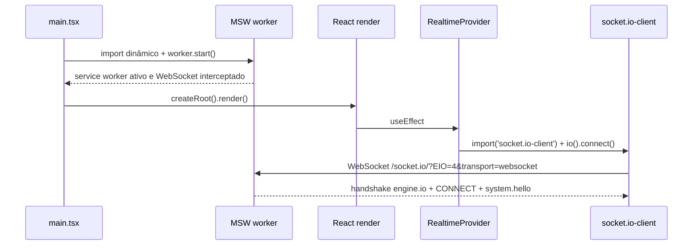

# Arquitetura — Kurio

Documento vivo: cada fase atualiza as seções que toca. Estado atual: **F0 (fundação)**.

## 1. Camadas e responsabilidades

- **`src/app`**: composição da aplicação. Variáveis de ambiente (`env.ts`), `QueryClient` com a política padrão de cache e retry (`query-client.ts`) e criação do router com contexto tipado (`router.ts`).
- **`src/routes`**: rotas file-based do TanStack Router. Devem ser finas: validação de search params, guards e ligação com as features. A árvore `src/routeTree.gen.ts` é gerada pelo plugin e versionada, para que `tsc -b` funcione num checkout limpo antes do build.
- **`src/contracts`**: tipos dos contratos, compartilhados por app, mocks e testes. Na F0 contém só os eventos Socket.IO.
- **`src/shared/api`**: a instância Axios única (`http.ts`) e a classificação de erros transitórios.
- **`src/shared/realtime`**: o único lugar que conhece o `socket.io-client`.
- **`src/shared/layout`**: estrutura e páginas genéricas (provisória, 404).
- **`src/components/ui`**: componentes shadcn/ui, adaptados aos tokens do Kurio.
- **`src/mocks`**: MSW. Handlers HTTP, servidor Socket.IO simulado e API de controle (`/__mock/*`). Nada fora daqui contém respostas fictícias.
- **`e2e`**: testes Playwright.

**Fronteiras garantidas por lint** (`eslint.config.js`):
- `msw`, `@mswjs/*` e `@/mocks/*` não podem ser importados fora de `src/mocks`. A única entrada é o `import()` dinâmico no `main.tsx`, que o `no-restricted-imports` não analisa; essa exceção é deliberada e única.
- `socket.io-client` só pode ser importado em `src/shared/realtime`.
- `fetch` global é proibido fora de `src/mocks`; chamadas REST passam pelo Axios.

Essas regras foram testadas com arquivos de exemplo: os três casos proibidos geram erro, e o mesmo código em `src/mocks` passa.

## 2. Bootstrap

O `main.tsx` usa top-level await. A renderização só acontece depois do `worker.start()`, de modo que nenhuma requisição e nenhuma conexão escapam do mock.

## 3. Tempo real: Socket.IO sobre MSW

**Transporte:** o app usa `socket.io-client` 4.8 com `transports: ['websocket']`. O MSW 2.15 intercepta o `WebSocket` dentro da página (não no service worker) com o handler `ws.link`. O `@mswjs/socket.io-binding` 0.2.0 traduz os pacotes engine.io e Socket.IO.

Três ajustes foram necessários. Todos foram descobertos e confirmados empiricamente na F0:

1. **O handler aponta para a origem, não para `/socket.io/`.** O MSW 2.15 remove o prefixo `/socket.io/` e a query da URL do cliente antes de comparar (`WebSocketHandler.parse`). Com `ws.link('ws://host/socket.io/')`, a URL real (`/socket.io/?EIO=4&transport=websocket`) não casava, e a conexão seguia para a rede, recebendo HTTP 200 do servidor estático. Uma expressão regular também não casa, porque a comparação é feita depois dessa limpeza. Isso foi confirmado executando o próprio `WebSocketHandler.test()` do MSW com as URLs candidatas.
2. **Heartbeat do engine.io.** O binding anuncia `pingInterval: 25000` e `pingTimeout: 5000` no handshake, mas nunca envia pings. O `socket.io-client` encerra a conexão por "ping timeout" após 30 s sem ping. O mock envia o pacote de ping (`2`) a cada 25 s. **Prova:** com o heartbeat desligado temporariamente, o teste de estabilidade registrou 3 conexões em 65 s, em vez de 1.
3. **`socket.io-client` carregado sob demanda.** O `engine.io-client` 6.6 guarda `globalThis.WebSocket` numa constante quando o módulo é avaliado (`transports/websocket.js`). Se ele fosse avaliado antes do `worker.start()`, usaria o `WebSocket` original, sem interceptação. O `createRealtimeSocket()` faz `import('socket.io-client')`, o que garante a ordem e tira a biblioteca do bundle inicial.

**Limitações conhecidas do transporte simulado.** As do binding foram confirmadas lendo o código instalado (`node_modules/@mswjs/socket.io-binding/src/index.ts`, versão 0.2.0):

- **Só WebSocket.** Long-polling HTTP do engine.io não é simulado.
- **Só o namespace padrão.** `emit` codifica sempre `nsp: '/'` (há um `@todo Support custom namespaces` no código), e o binding confirma o CONNECT com `40` (namespace `/`) por conta própria, num microtask, antes de ler qualquer pacote do cliente. Um cliente que pedisse `/orders` nunca seria confirmado nesse namespace.
- **Sem rooms nem broadcast.** São conceitos do servidor Socket.IO, que o binding não reimplementa. O mock só tem a lista de conexões que ele mesmo mantém (`activeConnections`).
- **Sem ACKs.** O listener recebe `(messageEvent, ...data)`, sem callback. Pacotes ACK do cliente são descartados, e o servidor não consegue responder com ACK.
- **ID de conexão fixo.** O handshake anuncia `sid: 'test'` no engine.io e no CONNECT, para todas as conexões. Assim, `socket.id` no cliente vale `'test'` sempre e não pode ser usado como identidade. O mock identifica conexões por `raw.client.id`, que o MSW gera de forma única.
- **Sem leitura do `auth`.** `on()` decodifica os pacotes, mas ignora tudo que não é EVENT. O pacote CONNECT, que carrega o `auth` do `io(url, { auth })`, nunca chega aos listeners. Como o binding confirma a conexão antes, também não há como recusá-la com CONNECT_ERROR (`44`) no fluxo nativo.

**Impacto no isolamento de usuários e no direcionamento de eventos (F1/F4):**
- Sem rooms, o mock precisa fazer o roteamento: manter um mapa `conexão → userId` e emitir cada evento só nas conexões do dono do recurso. Um "broadcast" vira um laço explícito sobre as conexões.
- Sem `auth` decodificado, o mock precisa ler a identidade de outra forma. Há dois candidatos, a validar na F1: escutar a mensagem bruta `40{...}` com `raw.client.addEventListener('message')` e decodificar o `auth`; ou receber o token na query da URL do handshake. Sem token válido, o mock deve encerrar a conexão (`raw.client.close`) e emitir um evento de erro antes, porque a recusa nativa não está disponível.
- Sem ACKs, toda confirmação vira um evento explícito de resposta, como em `system.ping`/`system.pong`.
- Tudo isso é limitação do servidor simulado. O cliente usa a API real do `socket.io-client`. Trocar o mock por um servidor Socket.IO real não exigiria mudanças no cliente, exceto passar a usar o `auth` nativo.

**Outras limitações:**
- A interceptação existe só na aba atual. Cada aba tem seu próprio "servidor".
- O DevTools do navegador não mostra frames dessas conexões como WebSocket de rede, e o `page.on('websocket')` do Playwright não as vê. A verificação é feita pela UI e pela API de controle do mock. A ausência de WebSocket de rede é justamente a evidência de que a conexão foi interceptada.

**Contrato dos eventos** (`src/contracts/events.ts`): envelope `{ eventId, type, resource: { kind, id }, version, occurredAt, userId?, payload }`. Na F0 existem `system.hello` (servidor → cliente, ao conectar) e `system.ping` / `system.pong` (eco).

## 4. MSW no deploy

- O build de produção é a demonstração: `.env.production` define `VITE_ENABLE_MOCKS=true`.
- `public/mockServiceWorker.js` é gerado por `npx msw init public --save` e mantido na versão do pacote (`msw.workerDirectory` no `package.json`).
- A Vercel serve o worker com `Cache-Control: no-cache, no-store, must-revalidate`, para evitar que uma versão antiga fique registrada.
- A SPA usa rewrite de todas as rotas para `index.html`. Limitação: rotas inexistentes respondem HTTP 200 com o app, que então renderiza a página 404.
- **Custo de performance:** o chunk do MSW tem cerca de 434 kB (cerca de 162 kB gzip) e é carregado antes do primeiro render. Será medido na sondagem de Lighthouse (F2).

## 5. Estado remoto e HTTP

- **Axios** (`src/shared/api/http.ts`): base `/api`, timeout de 10 s. Interceptors de sessão e normalização de erros entram na F1.
- **TanStack Query** (`src/app/query-client.ts`):
  - Queries: até 2 novas tentativas, só para erro de rede, timeout ou 5xx, com backoff exponencial limitado a 4 s; 4xx nunca é repetido.
  - `staleTime` padrão de 30 s; `refetchOnWindowFocus` desligado.
  - Mutations sem retry. A recuperação do pedido será feita com chave de idempotência (F4).

## 6. Estilo e design system

- **Tailwind CSS 4**, com configuração CSS-first: tokens do Figma no `@theme` de `src/index.css` (cores, escala tipográfica, sombras).
- **shadcn/ui** com base Radix, preset Nova. As variáveis semânticas (`--primary`, `--background`, ...) foram mapeadas para a paleta do Kurio. O app tem tema escuro único (`<html class="dark">`).
- O CLI 4.21 usa o pacote `cn` (mantido pelo shadcn) no lugar de `clsx` + `tailwind-merge`.
- **Fonte:** Roboto Mono 400/500/700, subset latin (que cobre os acentos do português), via `@fontsource/roboto-mono`. Os arquivos ficam no próprio bundle, sem requisição externa.

## 7. Testes

- Playwright com Chromium em dois projetos: `desktop` (1440×900) e `mobile` (Pixel 7, 390×844).
- Sem retries automáticos (`retries: 0`), para não esconder instabilidade. Traces ficam em `retain-on-failure` e o relatório HTML em `playwright-report/`.
- Os testes chamam a API de controle de dentro da página (`fetch` no contexto do navegador). A requisição passa pelo service worker do MSW, como qualquer requisição do app. Não há `page.route`.
- **Teste pulado de propósito:** `deployed build matches the expected commit` só roda quando `EXPECTED_COMMIT_SHA` está definido. No build local, o SHA embutido é sempre `local`, porque `VERCEL_GIT_COMMIT_SHA` só existe na Vercel. Por isso o teste só tem sentido contra o deploy, com `npm run test:e2e:deploy`. Localmente e no CI, ele aparece como 2 pulados (um por projeto).
- **CI** (`.github/workflows/ci.yml`): Node 24, `npm ci`, `npm run verify`, Chromium do Playwright com dependências do sistema e `npx playwright test` com a suíte completa, sem filtro de tags. O relatório HTML e os traces sobem como artefato, mesmo quando os testes falham (`if: !cancelled()`). O workflow não usa secrets.

## 8. Decisões

Cada item segue o formato: problema, escolha, alternativa descartada e motivo.

- **D1, versão do MSW:** o MSW 3.0.3 é o estável atual, mas o `@mswjs/socket.io-binding` 0.2.0 exige `msw ^2.10.2`. **Escolha:** MSW 2.15.0, a última 2.x. **Descartado:** MSW 3 com override de peer, porque o MSW 3 renomeou o evento `connection` e o binding não foi atualizado.
- **D2, match do handler Socket.IO:** **escolha:** `ws.link(origem)`, seguindo o comportamento do MSW para `/socket.io/`. **Descartado:** escrever um adaptador próprio, desnecessário depois que a causa foi encontrada.
- **D3, heartbeat no mock:** **escolha:** pings engine.io a cada 25 s no handler. **Descartado:** anunciar um `pingInterval` enorme, que exigiria reescrever o handshake do binding e esconderia o comportamento real do protocolo.
- **D4, import dinâmico do `socket.io-client`:** **escolha:** carregar sob demanda no módulo de tempo real. **Descartado:** carregar o app inteiro dinamicamente depois do MSW, o que somaria uma cascata de requisições ao carregamento inicial.
- **D5, `routeTree.gen.ts` versionado:** permite typecheck num checkout limpo sem rodar o plugin antes. **Descartado:** adicionar `@tanstack/router-cli` só para gerar o arquivo.
- **D6, `shadcn` em `devDependencies`:** o pacote só fornece o CLI e o `shadcn/tailwind.css`, um arquivo CSS resolvido no build, sem executar JavaScript do pacote. Com isso, `npm audit --omit=dev` fica com 0 vulnerabilidades. Isso **não** significa que o projeto está sem vulnerabilidades; veja a seção 9.
- **D7, sem retries no Playwright:** um teste instável deve ser corrigido na causa, não mascarado.

## 9. Resultados da F0

Execuções locais em 15/10/2026, Node 24.12, Chromium headless shell 156 (Playwright 1.64.1):

- `npm ci`: passou, sem alterar o `package-lock.json`.
- `npm run verify` (typecheck, lint, build): passou.
- `npm ci` + `npm run verify` numa cópia limpa do projeto, sem `node_modules`: passou.
- `npx playwright test`, suíte completa, desktop + mobile: **38 aprovados, 2 pulados, 0 falhas** (1,3 min). Os 2 pulados são o teste de versão do deploy (seção 7).
- `npm audit --omit=dev`: 0 vulnerabilidades nas dependências de produção.
- `npm audit` completo: **7 de severidade alta, todas só em desenvolvimento.** A origem é `braces@3.0.3` (GHSA-vfj7-8cjw-p6xm: negação de serviço por estouro de pilha com padrões glob muito aninhados), pela cadeia `shadcn` → (`@shadcn/registry`, `ts-morph` → `@ts-morph/common`) → `fast-glob` → `micromatch` → `braces`. O lockfile marca o `braces` como `dev: true`. Não há correção compatível: o advisory não tem versão corrigida, e o `npm audit fix --force` rebaixaria o `shadcn` para 1.0.0, incompatível com Tailwind 4. Impacto conhecido: só ao rodar o CLI do shadcn localmente com padrões glob de origem não confiável. Nada disso chega ao bundle, e o CI não executa o CLI. Vale reavaliar quando sair uma versão do shadcn com a cadeia atualizada.
- Prova de conceito do Socket.IO, local (desktop e mobile):
  - Evento recebido do mock, sem nenhum WebSocket de rede real visto pelo Playwright: passou. Quando o handler não casava, o Playwright registrava o WebSocket real; essa asserção prova que o worker interceptou a conexão.
  - Conexão estável por 65 s (1 conexão, 0 quedas): passou.
  - Reconexão após encerramento pelo servidor (motivo `transport close`, nova conexão, novo `system.hello`): passou.
- **Deploy na Vercel: ainda não verificado.** Depende de push e da conexão do repositório na Vercel.
- **CI no GitHub: ainda não executado.** Roda no primeiro push para `main` ou em pull requests.

## 10. Limitações e pendências

- As telas são provisórias e o header é temporário.
- A barra de diagnóstico será substituída pelo painel de cenários na F1.
- Se o `import('socket.io-client')` falhar (por exemplo, um chunk ausente depois de um novo deploy), o `RealtimeProvider` não trata o erro: o estado fica em "inativo" e a promise rejeitada não é capturada. Isso não simula sucesso, mas o estado de erro visível entra na F1, junto com `connect_error`.
- Assets do Figma (artes e ícones) serão exportados junto com as telas que os usam (F2).
